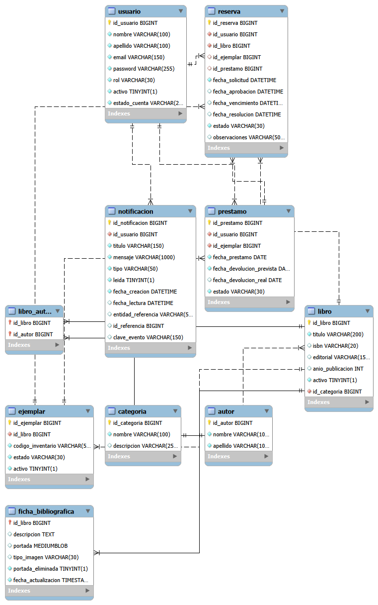

# Base de Datos - BiblioGest

## Descripción

BiblioGest utiliza MySQL como sistema de gestión de bases de datos relacionales. El modelo permite administrar el catálogo bibliográfico, los ejemplares físicos, los usuarios, los préstamos, las reservas, las fichas bibliográficas y las notificaciones internas.

La documentación corresponde al modelo actualizado en noviembre de 2026.

## Tablas del sistema

| Tabla | Responsabilidad |
| --- | --- |
| usuario | Identidad, autenticación, roles y estado de las cuentas. |
| categoria | Clasificación temática de los libros. |
| autor | Información de los autores. |
| libro | Información bibliográfica de las obras. |
| libro_autor | Asociación entre libros y autores. |
| ejemplar | Copias físicas, inventario y disponibilidad. |
| prestamo | Registro de préstamos y devoluciones. |
| ficha_bibliografica | Descripciones y portadas personalizadas. |
| reserva | Solicitudes, asignaciones y seguimiento de reservas. |
| notificacion | Avisos internos y seguimiento de lectura. |

## Usuario

Almacena los datos de identificación, correo electrónico, contraseña protegida mediante BCrypt, rol, indicador de actividad y estado de cuenta.

Roles:

- BIBLIOTECARIO.
- LECTOR.

Estados de cuenta:

- PENDIENTE.
- APROBADO.
- RECHAZADO.
- INACTIVO.

La baja lógica permite conservar el historial de operaciones del usuario.

## Categoría

Organiza los libros mediante una clasificación temática. Incluye identificador, nombre y descripción opcional.

## Autor

Almacena el identificador, nombre y apellido del autor.

## Libro

Representa la información bibliográfica de una obra:

- Identificador.
- Título.
- ISBN.
- Editorial.
- Año de publicación.
- Indicador de actividad.
- Categoría.

La editorial se representa como atributo y no como tabla independiente.

## Libro_Autor

Tabla intermedia que resuelve la relación de muchos a muchos entre libros y autores mediante una clave primaria compuesta.

## Ejemplar

Representa cada copia física de un libro. Contiene identificador, referencia al libro, código de inventario único, estado operativo e indicador de actividad.

Su estado permite controlar la disponibilidad para préstamos y reservas.

## Préstamo

Registra la circulación de ejemplares mediante:

- Identificador del préstamo.
- Usuario asociado.
- Ejemplar asociado.
- Fecha del préstamo.
- Fecha prevista de devolución.
- Fecha real de devolución.
- Estado.

Las devoluciones se registran actualizando el préstamo y la disponibilidad del ejemplar.

## Ficha bibliográfica

Complementa la información del libro con:

- Identificador del libro.
- Descripción.
- Imagen de portada.
- Tipo de imagen.
- Indicador de portada eliminada.
- Fecha de actualización.

Las imágenes personalizadas se almacenan en MySQL mediante MEDIUMBLOB.

La ficha es opcional y corresponde a un único libro.

## Reserva

Registra las solicitudes de reserva realizadas por los lectores.

Permite asociar usuarios, libros, ejemplares y préstamos según la etapa del proceso, además de registrar fechas, estado y observaciones.

La lógica de negocio controla las transiciones de estado, la disponibilidad y los vencimientos.

## Notificación

Almacena los avisos internos destinados a los usuarios.

Incluye información como título, mensaje, tipo de evento, estado de lectura, fechas y referencias a las operaciones relacionadas.

La clave de evento permite identificar notificaciones y controlar su duplicación.

## Relaciones principales

- Categoría 1:N Libro.
- Libro N:M Autor, mediante libro_autor.
- Libro 1:N Ejemplar.
- Usuario 1:N Préstamo.
- Ejemplar 1:N Préstamo histórico.
- Libro 1:0..1 Ficha bibliográfica.
- Usuario 1:N Reserva.
- Libro 1:N Reserva.
- Reserva: asociación opcional con ejemplar y préstamo.
- Usuario 1:N Notificación.

Las claves foráneas, restricciones, índices y tipos de datos exactos se encuentran definidos en schema.sql.

## Reglas de negocio

1. Cada ejemplar pertenece a un libro.
2. El código de inventario identifica de manera única a cada ejemplar.
3. Un ejemplar no debe tener dos préstamos activos simultáneos.
4. Los préstamos y devoluciones actualizan la disponibilidad.
5. Los lectores consultan sus propias operaciones.
6. Las operaciones administrativas requieren autorización de bibliotecario.
7. Las cuentas pendientes o rechazadas no pueden iniciar sesión.
8. Las contraseñas se almacenan mediante BCrypt.
9. Las reservas se gestionan de acuerdo con la disponibilidad y sus estados.
10. Las notificaciones internas identifican los eventos asociados.
11. La edición de fichas bibliográficas está reservada al bibliotecario.

## Diagrama Entidad-Relación

El siguiente diagrama fue actualizado a partir del modelo físico de MySQL.

[Modelo editable de MySQL Workbench](BiblioGest-Modelo-MySQL.mwb)

## Esquema SQL

[Consultar schema.sql](schema.sql)

El archivo contiene la estructura de la base de datos y sus relaciones.

### Instalación

1. Instalar MySQL y MySQL Workbench.
2. Conectarse al servidor local.
3. Abrir schema.sql.
4. Ejecutar el script sobre una base nueva y vacía.
5. Configurar la conexión del backend.
6. Preparar las cuentas y los datos iniciales necesarios.

No ejecutar el esquema de creación sobre una base existente con información sin realizar previamente un respaldo y revisar las instrucciones.

El esquema no incluye contraseñas reales, lectores registrados ni el inventario institucional completo.

## Acceso a datos

- MySQL.
- Spring Data JPA.
- Hibernate.
- JdbcTemplate para las operaciones de fichas bibliográficas.
- Spring Security.
- BCrypt.

El frontend se comunica con el backend mediante una API REST y no accede directamente a MySQL.

## Seguridad y mantenimiento

Se recomienda realizar respaldos periódicos, proteger las credenciales de conexión y evitar publicar datos personales o copias de producción en repositorios públicos.

La reconstrucción en una instancia limpia y el despliegue de producción deben validarse de manera independiente.