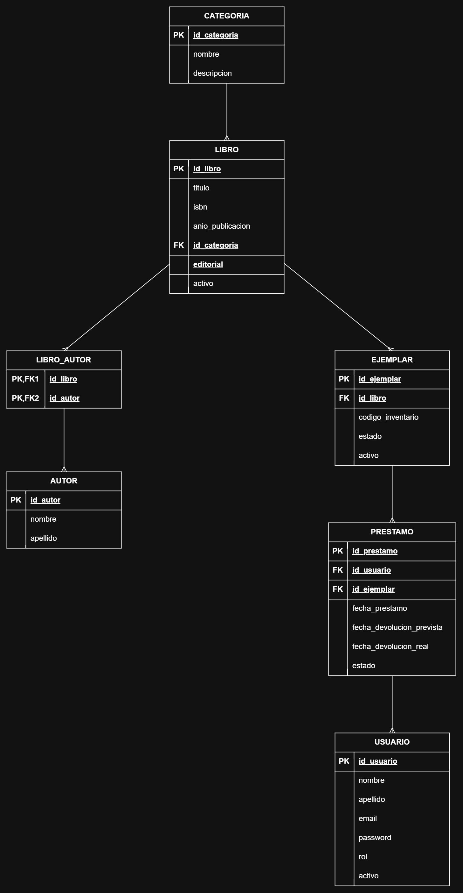

# Base de Datos - BiblioGest

## Descripción

BiblioGest utiliza **MySQL** para almacenar la información de la biblioteca escolar. La base de datos respalda la gestión de libros, autores, categorías, ejemplares, lectores y préstamos, así como las devoluciones y el control de acceso por roles.

Este documento describe **el modelo implementado actualmente**, diferenciándolo del diseño inicial. No se modifica la base de datos por actualizar esta documentación.

## Tablas principales de la implementación

- `usuario`
- `categoria`
- `autor`
- `libro`
- `libro_autor` (tabla intermedia)
- `ejemplar`
- `prestamo`

**Diferencia respecto del diseño inicial:** no se utiliza una tabla independiente `editorial`; el nombre de la editorial se guarda como atributo del libro. Tampoco se implementó una entidad independiente para devoluciones: la devolución se registra sobre el préstamo.

## Usuario

Representa a las personas registradas en el sistema.

Campos principales:

- `id_usuario`: identificador único.
- `nombre` y `apellido`: datos del usuario.
- `email`: correo utilizado para iniciar sesión.
- `password`: contraseña almacenada como **hash BCrypt**, no en texto plano.
- `rol`: `BIBLIOTECARIO` o `LECTOR`.
- `activo`: indica si la cuenta está habilitada; permite realizar baja lógica.

La aplicación utiliza Spring Security para autenticar al usuario y autorizar operaciones según su rol. Los lectores no pueden acceder a los endpoints administrativos.

## Categoria

Clasifica los libros del catálogo.

Campos principales:

- `id_categoria`: identificador único.
- `nombre`: nombre de la categoría.

> El diseño inicial incluía `descripcion`. Debe verificarse en el esquema SQL real si ese campo permanece en la tabla actual; no se considera indispensable para las funcionalidades del frontend probadas.

## Autor

Registra los autores de las obras.

Campos principales:

- `id_autor`: identificador único.
- `nombre`: nombre del autor.
- `apellido`: apellido del autor.

## Libro

Representa la información bibliográfica de una obra, independientemente de sus copias físicas.

Campos principales:

- `id_libro`: identificador único.
- `titulo`: título.
- `isbn`: identificador bibliográfico, cuando está disponible.
- `editorial`: nombre de la editorial, como texto.
- `anio_publicacion`: año de publicación, cuando se conoce.
- `activo`: indica si el libro está activo en el catálogo.
- `id_categoria`: referencia a la categoría.

Los autores se asocian mediante la tabla `libro_autor`.

## Libro_Autor

Resuelve la relación de muchos a muchos entre libros y autores.

Campos principales:

- `id_libro`: referencia al libro.
- `id_autor`: referencia al autor.

Un libro puede tener varios autores y un autor puede participar en varios libros.

## Ejemplar

Representa cada copia física de un libro.

Campos principales:

- `id_ejemplar`: identificador único.
- `id_libro`: libro al que pertenece.
- `codigo_inventario`: código identificatorio del ejemplar.
- `estado`: estado operativo del ejemplar, por ejemplo `DISPONIBLE` o el estado que corresponda mientras se encuentra prestado.
- `activo`: permite dar de baja lógicamente un ejemplar.

**Diferencia respecto del diseño inicial:** en la implementación probada, `estado` se usa para gestionar la **disponibilidad operativa**. No se está utilizando como un campo exclusivo de conservación física (`NUEVO`, `USADO`, `ROTO`). Tampoco se comprobó la implementación del atributo `ubicacion` propuesto inicialmente.

## Prestamo

Registra la circulación de ejemplares.

Campos principales:

- `id_prestamo`: identificador único.
- `id_usuario`: lector asociado.
- `id_ejemplar`: ejemplar prestado.
- `fecha_prestamo`: fecha de registro.
- `fecha_devolucion_prevista`: fecha límite prevista.
- `fecha_devolucion_real`: fecha efectiva de devolución, cuando corresponde.
- `estado`: situación del préstamo, por ejemplo `ACTIVO` mientras no se devolvió.

La devolución se registra actualizando el préstamo y el estado operativo del ejemplar; no requiere una tabla `devolucion` independiente.

## Relaciones principales

- **Categoria 1:N Libro:** una categoría agrupa varios libros; cada libro pertenece a una categoría.
- **Libro N:M Autor:** mediante `libro_autor`.
- **Libro 1:N Ejemplar:** un libro puede tener varias copias físicas.
- **Usuario 1:N Prestamo:** un lector puede tener varios préstamos a lo largo del tiempo.
- **Ejemplar 1:N Prestamo:** un ejemplar puede participar en distintos préstamos históricos, pero no debe tener dos préstamos activos simultáneos.

## Reglas de negocio implementadas y comprobadas

1. Los préstamos se asocian con un usuario y un ejemplar existentes.
2. Solo se puede registrar un préstamo de un ejemplar disponible.
3. Registrar un préstamo modifica la disponibilidad del ejemplar.
4. Registrar una devolución actualiza el préstamo y devuelve el ejemplar a la condición de disponible.
5. Cada ejemplar se identifica mediante un código de inventario.
6. Los usuarios poseen un rol: `LECTOR` o `BIBLIOTECARIO`.
7. Las contraseñas se almacenan con BCrypt.
8. La desactivación de un lector es una baja lógica: el registro se conserva con `activo = false`.
9. Las operaciones administrativas están restringidas al bibliotecario mediante Spring Security.

## Pruebas funcionales realizadas

Se comprobaron desde la aplicación web las siguientes operaciones:

1. Registro de un libro.
2. Registro de un ejemplar.
3. Registro de un lector.
4. Modificación de datos de un lector.
5. Registro de un préstamo y actualización de disponibilidad.
6. Registro de una devolución y recuperación de disponibilidad.
7. Desactivación lógica de un lector.

También se comprobó la diferenciación de acceso entre visitante, lector y bibliotecario. Estas pruebas funcionales no reemplazan una revisión completa del esquema, restricciones e índices de MySQL.

## Diagrama Entidad-Relación

El diagrama elaborado en la etapa de diseño inicial está disponible en:

**Atención:** este DER corresponde al diseño original. Antes de presentarlo como diagrama definitivo, se debe revisar y actualizar para reflejar las tablas y columnas reales de la implementación, especialmente el tratamiento de `editorial`, `estado` de ejemplares y la ausencia de `ubicacion` en las funcionalidades comprobadas.

## Script SQL

El repositorio incluye el script de la etapa de diseño:

[Ver script SQL de BiblioGest](schema.sql)

**Atención:** el script debe contrastarse con el esquema que utiliza actualmente Spring Boot y MySQL. No se afirma que pueda reconstruir íntegramente la base de datos actual sin verificar sus tablas, columnas, claves y restricciones.

## Tecnologías y acceso a datos

- MySQL como motor relacional.
- Java 17 y Spring Boot en el backend.
- Spring Data JPA e Hibernate para persistencia.
- Spring Security y BCrypt para autenticación, autorización y protección de contraseñas.

La aplicación frontend se comunica con la API REST; no accede directamente a MySQL.

## Pendientes de documentación técnica

- Comparar `schema.sql` con las tablas actuales de MySQL.
- Actualizar `DER-BiblioGest.png` si aún representa el modelo inicial.
- Verificar los nombres exactos, tipos de datos, índices y restricciones del esquema físico.
- Documentar un procedimiento de creación de la base de datos desde cero que se haya probado en un entorno limpio.
