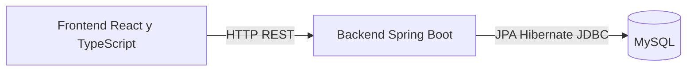
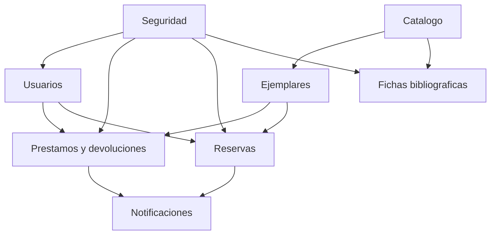

# Módulos del Sistema - BiblioGest

## Introducción

BiblioGest es una aplicación web de gestión bibliotecaria escolar. Sus módulos organizan las responsabilidades funcionales dentro de una arquitectura cliente-servidor.

Los módulos forman parte de una misma aplicación y no constituyen microservicios independientes.

## Arquitectura

- Frontend: React, TypeScript, Vite y React Router.
- Backend: Java 17, Spring Boot y API REST.
- Persistencia: MySQL, Spring Data JPA, Hibernate y JdbcTemplate.
- Seguridad: Spring Security, HTTP Basic y BCrypt.

## 1. Usuarios

Responsabilidad: administrar las cuentas de la biblioteca.

- Registro administrativo de lectores.
- Consulta y modificación de datos.
- Baja lógica.
- Solicitudes de registro.
- Aprobación y rechazo de cuentas.
- Control del estado de cuenta.

## 2. Autenticación y autorización

Responsabilidad: identificar usuarios y controlar permisos.

- Inicio y cierre de sesión.
- Validación de credenciales.
- Contraseñas protegidas mediante BCrypt.
- Roles BIBLIOTECARIO y LECTOR.
- Acceso público al catálogo.
- Restricción de operaciones administrativas en el backend.
- Navegación diferenciada según el perfil.

## 3. Catálogo bibliográfico

Responsabilidad: organizar la información de los libros.

- Registro y consulta de libros.
- Asociación con autores y categorías.
- Información editorial y año de publicación.
- Consulta de libros activos.
- Búsqueda y filtros.
- Ordenamiento y paginación.
- Consulta de disponibilidad.

La editorial se almacena como atributo del libro.

## 4. Ejemplares

Responsabilidad: administrar las copias físicas.

- Registro de ejemplares.
- Asociación con libros.
- Identificación mediante código de inventario.
- Control de disponibilidad.
- Actualización del estado operativo.

## 5. Préstamos y devoluciones

Responsabilidad: gestionar la circulación de materiales.

- Registro de préstamos.
- Buscadores de lectores y ejemplares.
- Selección de ejemplares disponibles.
- Fecha prevista de devolución.
- Consulta administrativa de préstamos.
- Registro de devoluciones.
- Recuperación de disponibilidad.
- Consulta de préstamos propios por el lector.

## 6. Consulta pública del catálogo

Responsabilidad: facilitar el acceso a los recursos bibliográficos.

- Acceso sin autenticación.
- Búsqueda de materiales.
- Visualización de autores, categorías y editoriales.
- Consulta de disponibilidad.
- Acceso a fichas bibliográficas.
- Navegación por resultados paginados.

## 7. Fichas bibliográficas

Responsabilidad: enriquecer la presentación de los libros.

- Visualización de información bibliográfica.
- Descripciones personalizadas.
- Carga, sustitución y eliminación de portadas.
- Validación de imágenes JPG y PNG.
- Almacenamiento de imágenes personalizadas en MySQL.
- Portadas visuales alternativas para libros sin imagen original.
- Edición restringida al bibliotecario.

## 8. Reservas

Responsabilidad: gestionar solicitudes de materiales bibliográficos.

- Solicitud de reservas por lectores.
- Consulta y seguimiento de reservas.
- Gestión administrativa de solicitudes.
- Asociación con ejemplares y préstamos según corresponda.
- Control de disponibilidad y vencimientos.

## 9. Notificaciones

Responsabilidad: comunicar eventos relevantes dentro del sistema.

- Centro de notificaciones internas.
- Avisos relacionados con reservas.
- Recordatorios de devolución.
- Avisos de préstamos vencidos.
- Seguimiento del estado de lectura.
- Generación automática mediante tareas programadas.
- Identificación de eventos para controlar duplicados.

No incluye envío de correos electrónicos ni mensajería externa.

## Roles y permisos

| Funcionalidad | Visitante | Lector | Bibliotecario |
| --- | --- | --- | --- |
| Consultar catálogo | Sí | Sí | Sí |
| Buscar libros | Sí | Sí | Sí |
| Consultar fichas | Sí | Sí | Sí |
| Solicitar una cuenta | Sí | No | No |
| Consultar préstamos propios | No | Sí | No aplica |
| Solicitar reservas | No | Sí | No aplica |
| Gestionar libros y ejemplares | No | No | Sí |
| Gestionar lectores | No | No | Sí |
| Gestionar préstamos y devoluciones | No | No | Sí |
| Administrar reservas | No | No | Sí |
| Editar fichas bibliográficas | No | No | Sí |

## Dependencias funcionales

## Pruebas funcionales realizadas

Durante el desarrollo se realizaron pruebas manuales y consultas a la API y a MySQL para verificar operaciones como:

- Registro de libros y ejemplares.
- Registro y modificación de lectores.
- Baja lógica de usuarios.
- Aprobación y rechazo de cuentas.
- Registro de préstamos y devoluciones.
- Actualización de disponibilidad.
- Acceso diferenciado por roles.
- Consulta del catálogo público.
- Carga de descripciones y portadas.
- Generación de recordatorios y avisos de préstamos vencidos.

Estas comprobaciones no sustituyen una batería completa de pruebas automatizadas ni una auditoría de seguridad.

## Alcance y limitaciones

El sistema funciona en entorno local.

Las reservas, las notificaciones internas y las fichas bibliográficas representan ampliaciones del MVP original.

No se incluye una aplicación móvil nativa, gestión de múltiples bibliotecas, pagos en línea, recomendaciones automáticas ni integración con servicios externos de mensajería.

La sesión del frontend se mantiene en memoria. Para un despliegue público se requiere revisar la autenticación, HTTPS, configuración de producción y protección de datos personales.