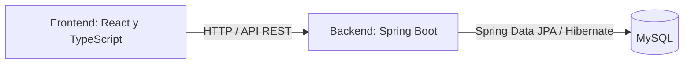

# Módulos del Sistema - BiblioGest

## Introducción

BiblioGest es una aplicación web para organizar el catálogo y la circulación de materiales de una biblioteca escolar. El proyecto se divide en módulos funcionales para ordenar el desarrollo y facilitar su mantenimiento. Los módulos forman parte de una misma aplicación; no son microservicios independientes.

Este documento distingue entre las funcionalidades **implementadas y comprobadas en las pruebas realizadas** y las **previstas o pendientes de verificar**. De esta manera, la documentación refleja el avance real del proyecto.

## Arquitectura general

BiblioGest utiliza una arquitectura cliente-servidor:

- **Frontend:** React, TypeScript y Vite. React Router permite navegar entre las pantallas y utilizar las funciones Atrás y Adelante del navegador.
- **Backend:** Java 17 y Spring Boot, con API REST, reglas de negocio y control de acceso mediante Spring Security.
- **Persistencia:** Spring Data JPA, Hibernate y MySQL.
- **Autenticación:** HTTP Basic para las solicitudes autenticadas; contraseñas almacenadas mediante BCrypt. Los permisos se verifican en el backend según el rol.

## 1. Módulo de Usuarios

**Responsabilidad:** administrar los usuarios de la biblioteca.

**Implementado y comprobado:**

- Registrar lectores.
- Consultar usuarios activos desde la pantalla administrativa.
- Modificar datos de un lector.
- Desactivar lectores mediante baja lógica, sin eliminar su historial.
- Distinguir los roles `LECTOR` y `BIBLIOTECARIO`.

La gestión administrativa está reservada al bibliotecario. La desactivación de un lector fue comprobada en las pruebas funcionales.

## 2. Módulo de Catálogo

**Responsabilidad:** mantener la información bibliográfica de los libros.

**Implementado y comprobado:**

- Registrar libros desde la interfaz administrativa.
- Consultar el catálogo de libros activos.
- Buscar libros desde el catálogo público.
- Relacionar los libros con la información de categorías y autores utilizada por el sistema.

**Previsto o pendiente de verificar en la interfaz:**

- Edición de los datos de un libro.
- Administración completa de autores, categorías y editoriales como operaciones independientes.

La mención de editoriales corresponde al alcance del proyecto; no se da por comprobado un módulo administrativo independiente de editoriales.

## 3. Módulo de Ejemplares

**Responsabilidad:** registrar los ejemplares físicos asociados a los libros y controlar su disponibilidad.

**Implementado y comprobado:**

- Registrar un ejemplar asociado a un libro.
- Identificarlo mediante un código de inventario.
- Consultar la disponibilidad en el catálogo.
- Actualizar la disponibilidad cuando se registra un préstamo o una devolución.

**Previsto o pendiente de verificar:**

- Administración detallada del estado físico y la ubicación de los ejemplares.

## 4. Módulo de Préstamos y Devoluciones

**Responsabilidad:** registrar y controlar la circulación de ejemplares.

**Implementado y comprobado:**

- Registrar un préstamo asociado a un lector y a un ejemplar disponible.
- Registrar la fecha prevista de devolución.
- Consultar préstamos desde la pantalla administrativa.
- Registrar la devolución de un ejemplar.
- Actualizar la disponibilidad del ejemplar después del préstamo y la devolución.
- Mantener el registro de la operación después de actualizar la página.

**Previsto o pendiente de implementar o verificar:**

- Una pantalla específica para que cada lector consulte exclusivamente sus propios préstamos.
- Indicadores o filtros adicionales para préstamos vencidos, si fueran requeridos.

## 5. Módulo de Autenticación y Roles

**Responsabilidad:** identificar a los usuarios y restringir el acceso a las operaciones según sus permisos.

**Implementado y comprobado:**

- Inicio y cierre de sesión desde el frontend.
- Validación de credenciales mediante Spring Security.
- Almacenamiento de contraseñas con BCrypt.
- Identificación de los roles `BIBLIOTECARIO` y `LECTOR`.
- Consulta de la identidad autenticada mediante `/api/auth/me`.
- Acceso público a las consultas habilitadas del catálogo.
- Restricción de operaciones administrativas en el backend.
- Ocultamiento de opciones administrativas para visitantes y lectores.
- Navegación con React Router, con funcionamiento comprobado de Atrás y Adelante.

**Limitación actual:** la sesión del frontend se mantiene en memoria. Al actualizar la página, puede ser necesario volver a iniciar sesión. El mecanismo HTTP Basic se utiliza en el entorno de desarrollo local; un despliegue público requiere HTTPS y una revisión específica de la gestión de sesiones y credenciales.

## 6. Módulo de Consulta del Catálogo

**Responsabilidad:** permitir que visitantes y lectores consulten el material bibliográfico sin acceder a las funciones de mantenimiento.

**Implementado y comprobado:**

- Visualizar el catálogo sin iniciar sesión.
- Buscar libros mediante el buscador disponible.
- Consultar la información mostrada de cada libro.
- Conocer la disponibilidad de ejemplares.
- Acceder a la consulta como visitante o como lector autenticado.

Los criterios de búsqueda efectivamente disponibles deben verificarse contra la interfaz antes de afirmar que todos los filtros por título, autor y categoría están implementados de manera independiente.

## Dependencias principales entre módulos

- **Préstamos y Devoluciones** utiliza datos de **Usuarios** y **Ejemplares** para identificar al lector y el material prestado.
- **Ejemplares** depende de **Catálogo**, porque cada ejemplar corresponde a un libro.
- **Consulta del Catálogo** utiliza datos de **Catálogo** y **Ejemplares** para mostrar información y disponibilidad.
- **Autenticación y Roles** determina qué operaciones pueden realizarse desde los demás módulos.
- **Catálogo** utiliza información de autores y categorías para organizar los libros; la gestión de editoriales forma parte del alcance previsto.

Estas relaciones son dependencias funcionales internas, no servicios desplegados por separado.

## Pruebas funcionales realizadas

Se comprobaron las siguientes operaciones desde la interfaz con sesión de bibliotecario:

1. Registro de un libro.
2. Registro de un ejemplar.
3. Registro de un lector.
4. Edición de los datos del lector.
5. Registro de un préstamo y actualización de la disponibilidad.
6. Registro de la devolución y recuperación de la disponibilidad.
7. Desactivación lógica de un lector.

También se comprobó el acceso al catálogo como visitante, el acceso de consulta como lector, el acceso administrativo como bibliotecario y el funcionamiento de la navegación Atrás/Adelante.

Estas pruebas confirman las operaciones indicadas, pero no sustituyen una batería completa de pruebas automatizadas, de seguridad y de despliegue.

## Organización general

Los módulos permiten distribuir responsabilidades y mantener una separación clara entre interfaz, reglas de negocio y persistencia. El desarrollo actual funciona en entorno local y la documentación se actualizará a medida que se implementen o verifiquen las funcionalidades restantes.
