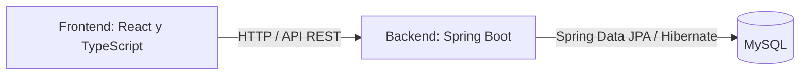

# Módulos del Sistema - BiblioGest

## Introducción

BiblioGest es una aplicación web para organizar el catálogo y la circulación de materiales de una biblioteca escolar. El proyecto se divide en módulos funcionales para ordenar el desarrollo y facilitar su mantenimiento. Los módulos forman parte de una misma aplicación; no son microservicios independientes.

Este documento describe funcionalidades implementadas en el código y distingue la cobertura automatizada de las comprobaciones manuales aún no realizadas. La matriz vigente está en [VERIFICACION_MVP.md](VERIFICACION_MVP.md).

## Arquitectura general

BiblioGest utiliza una arquitectura cliente-servidor:

- **Frontend:** React, TypeScript, Vite y React Router para las vistas SPA y el historial de rutas.
- **Backend:** Java 17 y Spring Boot, con API REST, reglas de negocio y control de acceso mediante Spring Security.
- **Persistencia:** Spring Data JPA, Hibernate y MySQL.
- **Autenticación:** HTTP Basic para las solicitudes autenticadas; contraseñas almacenadas mediante BCrypt. Los permisos se verifican en el backend según el rol.

## 1. Módulo de Usuarios

**Responsabilidad:** administrar los usuarios de la biblioteca.

**Implementado y comprobado:**

- Registrar lectores.
- Consultar usuarios activos desde la pantalla administrativa.
- Modificar datos de un lector.
- Desactivar lectores mediante baja lógica, sin eliminar su historial.
- Distinguir los roles `LECTOR` y `BIBLIOTECARIO`.

La gestión administrativa está reservada al bibliotecario. La desactivación de un lector fue comprobada en las pruebas funcionales.

## 2. Módulo de Catálogo

**Responsabilidad:** mantener la información bibliográfica de los libros.

**Implementado y comprobado:**

- Registrar libros desde la interfaz administrativa.
- Consultar el catálogo de libros activos.
- Buscar libros desde el catálogo público.
- Relacionar los libros con la información de categorías y autores utilizada por el sistema.

Autores y categorías tienen operaciones administrativas propias. No existe módulo, entidad ni tabla de editoriales: su nombre es un campo de `Libro`. En F09 se aprobaron desde React la creación y edición de autores y categorías, además de la edición de libros y sus asociaciones (T09, T10 y T13).

## 3. Módulo de Ejemplares

**Responsabilidad:** registrar los ejemplares físicos asociados a los libros y controlar su disponibilidad.

**Implementado y comprobado:**

- Registrar un ejemplar asociado a un libro.
- Identificarlo mediante un código de inventario.
- Consultar la disponibilidad en el catálogo.
- Actualizar la disponibilidad cuando se registra un préstamo o una devolución.

Se pueden registrar y editar `ubicacion` y `estadoFisico` (`BUENO`, `REGULAR`, `DANADO`). El indicador `activo`, el estado físico y el estado de circulación (`DISPONIBLE`/`PRESTADO`) son distintos. En F09 se aprobó desde React la edición y persistencia de los datos físicos de ejemplares (T18); la migración histórica se verificó por separado en MySQL de ensayo.

## 4. Módulo de Préstamos y Devoluciones

**Responsabilidad:** registrar y controlar la circulación de ejemplares.

**Implementado y comprobado:**

- Registrar un préstamo asociado a un lector y a un ejemplar disponible.
- Registrar la fecha prevista de devolución.
- Permitir que cada lector consulte únicamente sus propios préstamos.
- Consultar préstamos desde la pantalla administrativa.
- Registrar la devolución de un ejemplar.
- Actualizar la disponibilidad del ejemplar después del préstamo y la devolución.
- Calcular dinámicamente `vencido` cuando la fecha prevista es anterior a hoy y el préstamo sigue abierto; la consulta no cambia el registro.

La UI presenta “Mis préstamos” al lector y un filtro de vencidos al bibliotecario. En F09 se aprobaron desde React la creación de préstamos y las devoluciones. La pantalla de vencidos se visualizó, pero no se afirma que se haya comprobado manualmente un préstamo realmente vencido; la regla de fechas cuenta además con pruebas automatizadas.

## 5. Módulo de Autenticación y Roles

**Responsabilidad:** identificar a los usuarios y restringir el acceso a las operaciones según sus permisos.

**Implementado y comprobado:**

- Inicio y cierre de sesión desde el frontend.
- Validación de credenciales mediante Spring Security.
- Almacenamiento de contraseñas con BCrypt.
- Identificación de los roles `BIBLIOTECARIO` y `LECTOR`.
- Consulta de la identidad autenticada mediante `/api/auth/me`.
- Acceso público a las consultas habilitadas del catálogo.
- Restricción de operaciones administrativas en el backend.
- Opciones administrativas ocultas para visitantes y lectores; la autorización real se mantiene en el backend.

**Limitación actual:** la sesión del frontend se mantiene en memoria. En F09 se observó que, tras F5, tanto BIBLIOTECARIO como LECTOR deben iniciar sesión nuevamente; este comportamiento se acepta en el MVP y no se guardan contraseñas ni cabeceras Basic en `localStorage` o `sessionStorage`. HTTP Basic se limita al desarrollo local; un despliegue público requiere HTTPS y una revisión de seguridad del entorno.

## 6. Módulo de Consulta del Catálogo

**Responsabilidad:** permitir que visitantes y lectores consulten el material bibliográfico sin acceder a las funciones de mantenimiento.

**Implementado y comprobado:**

- Visualizar el catálogo sin iniciar sesión.
- Buscar libros mediante el buscador disponible.
- Consultar la información mostrada de cada libro.
- Conocer la disponibilidad de ejemplares.
- Acceder a la consulta como visitante o como lector autenticado.

La API ofrece consultas del catálogo activo y la interfaz una búsqueda. En F09 se verificaron en navegador las rutas y restricciones de roles, el historial Atrás/Adelante y la navegación por teclado; el detalle por criterio está en [VERIFICACION_MVP.md](VERIFICACION_MVP.md).

## Dependencias principales entre módulos

- **Préstamos y Devoluciones** utiliza datos de **Usuarios** y **Ejemplares** para identificar al lector y el material prestado.
- **Ejemplares** depende de **Catálogo**, porque cada ejemplar corresponde a un libro.
- **Consulta del Catálogo** utiliza datos de **Catálogo** y **Ejemplares** para mostrar información y disponibilidad.
- **Autenticación y Roles** determina qué operaciones pueden realizarse desde los demás módulos.
- **Catálogo** utiliza autores y categorías para organizar los libros; la editorial es un atributo de `Libro`, sin módulo independiente.

Estas relaciones son dependencias funcionales internas, no servicios desplegados por separado.

## Verificación automatizada y manual

La suite de backend cubre las reglas REST descritas en este documento. En F09 se aprobaron desde React la gestión de usuarios, autores, categorías, edición de libros y ejemplares, y los flujos de préstamo/devolución. Se verificaron además permisos por rol, concurrencia funcional y migración F06 en MySQL de ensayo. El detalle y los límites de cada caso están en [VERIFICACION_MVP.md](VERIFICACION_MVP.md).

## Organización general

Los módulos distribuyen responsabilidades entre interfaz, reglas de negocio y persistencia. La suite automatizada de F09 usó H2 en memoria; las verificaciones adicionales sobre MySQL/InnoDB están identificadas por separado en la matriz de F09.
